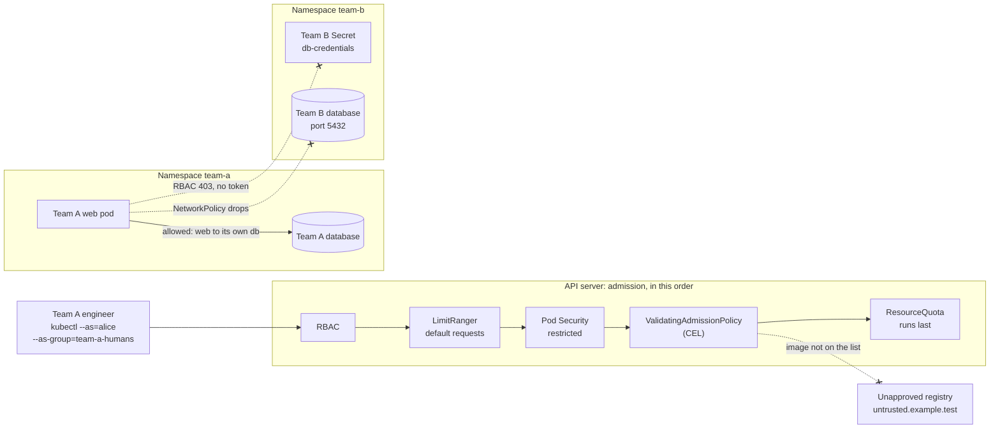

# Architecture: hardening a shared namespace

This document describes what the code and manifests in this repository do and why they are shaped this way. Component names match the diagram in the lesson ("Five attacks, five controls"): **Team A engineer (client)**, **Team A web pod**, **Unapproved registry**, **Worker node**, **Cluster memory**, **Team B Secret** and **Team B database**, inside the **Namespace team-a** and **Namespace team-b**.

## Components and what each owns

| Component | Where it lives | What it owns |
| --- | --- | --- |
| **Team A engineer (client)** | the identity `alice` in group `team-a-humans`, used by [`scripts/run-attacks.sh`](scripts/run-attacks.sh) and the tests through `kubectl --as` | Everything a tenant does through the API: apply manifests, ask who it is, ask what it may do. |
| **Team A web pod** and its database | [`manifests/base`](manifests/base), code in [`src/tenant_web`](src/tenant_web), SQL in [`sql`](sql) | A small service that counts visits in its team's Postgres. It is both the workload to protect and the foothold for attack 3, which runs from inside it. |
| **Namespace team-a, team-b** | [`manifests/overlays/*/team-*`](manifests/overlays) | The boundary every control is attached to. Created with the label `platform.example/tenant: "true"` so the cluster-wide admission policy covers it. |
| **Pod Security** | [`manifests/controls/pod-security`](manifests/controls/pod-security) | Labels on the namespace: enforce, warn and audit the `restricted` standard. Stops attacks 1 and 1b. |
| **RBAC** | [`manifests/controls/rbac`](manifests/controls/rbac), [`identity`](manifests/identity) | A Role for the team's developers in its own namespace and a RoleBinding to the team's group; service accounts without mounted tokens. Stops attack 2. |
| **NetworkPolicy** | [`manifests/controls/network-policy`](manifests/controls/network-policy) | Default deny both ways, DNS to kube-dns, web to its own database on 5432. Stops attack 3. |
| **Quota and defaults** | [`manifests/controls/quota`](manifests/controls/quota) | A ResourceQuota on requests and object counts, and a LimitRange of default requests. Stops attack 4. |
| **Policy in CEL** | [`manifests/platform/admission-policy`](manifests/platform/admission-policy) | A ValidatingAdmissionPolicy and its binding: images from the approved registry only, every container with a memory limit. Stops attacks 5 and 6. |
| **Unapproved registry** | `untrusted.example.test` in [`attacks/05-unapproved-image.yaml`](attacks/05-unapproved-image.yaml) | Nothing: it is a name that the policy refuses; no pull is ever attempted. |
| **The attacks** | [`attacks/`](attacks) and [`scripts/run-attacks.sh`](scripts/run-attacks.sh) | One file per attack and one verdict per file. |
| **Stages** | [`scripts/stage.sh`](scripts/stage.sh), [`manifests/overlays`](manifests/overlays) | Putting both namespaces in `baseline`, `hardened` or "hardened without one control". |
| **The threat model** | [`docs/threat-model.md`](docs/threat-model.md) | The plan, checked against the attacks folder by `tests/policy`. |

## Pattern: layers in the app, components for the controls

The web service has the same shape as a real one. A team name and a visit count are validated values in `domain`; `application` has two use cases and one port, `VisitStore`; `infrastructure` implements it with `psycopg` and a pool with explicit timeouts; `interfaces` is Flask and the composition root. Unit tests replace the port with an in-memory fake; integration tests run the same adapter, and the repository's own SQL scripts, against a real Postgres. The dependency rule is enforced by import-linter, with a second contract that keeps `psycopg` and `flask` out of the inner layers.

The controls follow the same idea at the cluster level: a control is a Kustomize **Component** that can be added to or left out of a team's overlay, and nothing in `base` knows which controls are on. [ADR 0001](docs/adr/0001-controls-are-kustomize-components-and-each-has-one-attack.md) records why. Because every object a control creates carries the label `platform.example/control=<name>`, `scripts/stage.sh` can remove exactly one control's objects.

## Data flow

Drawn versions of this figure and of the walk-through: [the architecture](docs/diagrams/architecture.svg) and [one run](docs/diagrams/flow.svg).

### One attack, step by step: attack 4, memory exhaustion (`scripts/run-attacks.sh attacks/04-exhaust-memory.yaml`)

1. The runner applies the Deployment as `alice`. The API server authenticates the impersonated identity and RBAC allows `create deployments` in `team-a` (the Role grants it).
2. Admission checks the Deployment object itself. It is valid and breaks no rule, so it is stored with `replicas: 50`.
3. The Deployment controller creates a ReplicaSet and the ReplicaSet controller starts creating pods. Each pod create goes through admission again: the LimitRanger finds requests set, Pod Security passes (the pod is `restricted`-compliant), the policy passes (approved image, memory limit set), and the ResourceQuota, which runs last, adds the pod's requests to the namespace's usage.
4. At the fourth or so pod the quota's `requests.memory` of 4 GiB would be exceeded. Admission refuses the pod with `exceeded quota: team-quota, requested: requests.memory=1Gi, used: ..., limited: requests.memory=4Gi`, and the ReplicaSet records a `FailedCreate` event with that message.
5. The runner waits fifteen seconds, counts the pods that exist (well under 50) and reads the `FailedCreate` event. Fewer than fifty pods and a quota message in the events is `BLOCKED (ResourceQuota: held at N/50)`.
6. The runner deletes the Deployment and waits for its pods to go.

The same steps in the baseline create all fifty pods, which is `SUCCEEDED`.

## Decisions and trade-offs

**Every attack breaks exactly one rule.** Admission plugins run in a fixed order (the LimitRanger, then Pod Security, then validating policies, then the ResourceQuota last). A pod that broke two rules would be refused by the first one to look, and the test would credit the wrong control. So attack 1's pod is otherwise approved and limited; attack 4's pods are otherwise `restricted`-compliant; attack 5's pod is compliant; and so on. [ADR 0001](docs/adr/0001-controls-are-kustomize-components-and-each-has-one-attack.md).

**Three runs of the same attacks.** Baseline (every attack succeeds), hardened (every attack is blocked) and one control off (exactly that control's attacks succeed). An attack that is blocked in the hardened stage proves nothing alone; it may be malformed, or stopped by a different layer. The cluster test asserts all three.

**The shortcut is part of the baseline.** The lesson warns about binding a team to a `ClusterRole`/`ClusterRoleBinding` "just for convenience". The baseline does exactly that (the built-in `edit` role, cluster-wide), because without it the lesson's RBAC attack would not succeed anywhere: Kubernetes denies by default. With it, attack 2 reads team B's Secret.

**RBAC: a Role for people, nothing for workloads.** The Role gives developers Deployments, Pods, Services, ConfigMaps and logs in their own namespace. It does not give Secrets, `pods/exec`, RBAC objects, quotas or any wildcard. The web and database service accounts have no Role at all and no mounted token, so even a compromised pod has nothing to call the API with. Developers can create Pods directly because the attacks need that to reach admission; a stricter platform would allow Deployments only.

**NetworkPolicy: deny both directions, then allow narrowly.** Default deny covers ingress and egress for every pod, because egress left open lets the web pod start a connection to the other team's database. DNS is allowed to the `kube-dns` pods only, on port 53, since without it no name resolves and the namespace looks broken instead of isolated. The one application flow is written at both ends (web egress to db, db ingress from web) with pod selectors and no namespace selector, so it can only mean this namespace. The kubelet's health probes come from the node and are not affected.

**Quota: requests, not limits.** The quota caps `requests.cpu`, `requests.memory`, `pods`, Deployments and Secrets. A quota on `limits.memory` would also demand limits on every pod, but the ResourceQuota runs after the policy, so a pod with no limits is still refused by the policy first and the quota would only add a second counter. The LimitRange supplies default **requests** and no default limit: a default limit would make the policy's limits rule unreachable.

**The admission policy is CEL, not a webhook.** It runs inside the API server, fails closed, and needs no deployment or certificates. [ADR 0002](docs/adr/0002-admission-policy-in-cel-not-a-webhook.md). It requires a memory limit, not a CPU limit: a memory limit is what stops a container from taking its node's memory.

**The registry is a name.** [ADR 0003](docs/adr/0003-approved-registry-is-a-name-and-images-are-loaded-into-nodes.md).

**The databases' init scripts are the repository's SQL.** The `db-init` ConfigMap is generated from `sql/001_schema.sql` and `sql/002_seed.sql`, which the Postgres image runs on first start. The same files are what `make db` runs and what the integration test mounts, so there is one copy of the schema.

**Security context everywhere, including the database.** Non-root (the `postgres` user, uid 70, in the Alpine image), `RuntimeDefault` seccomp, no privilege escalation, every capability dropped, a read-only root filesystem with `emptyDir` volumes for the data directory, the socket directory and `/tmp`. The `restricted` standard is enforced on both namespaces in the hardened stage, and `tests/policy` checks that every workload would pass it.

**Passwords never touch the repository.** `scripts/create-secrets.sh` generates one per team at deploy time; Postgres reads it from `POSTGRES_PASSWORD` and the web service from `DB_PASSWORD`, both from the same Secret.

## Failure modes the lesson teaches, and how to reproduce each

| Failure | What you see | Reproduce |
| --- | --- | --- |
| Network plugin that ignores policy | Every NetworkPolicy applies and attack 3 still connects. | Add `--disable-network-policy` to the k3s arguments in `cluster/k3d-config.yaml`, recreate the cluster (`make down`, `make up`), `make run` |
| Default deny for ingress only | Egress stays open, so attack 3 still connects from the web pod. | Remove `Egress` from `policyTypes` in `manifests/controls/network-policy/default-deny.yaml` |
| No DNS rule | The web pod cannot resolve `db`; readiness fails; attack 3 prints INCONCLUSIVE. | Delete `allow-dns.yaml` from the network-policy component |
| A cluster-wide role binding | Attack 2 succeeds. | `make baseline` (or `make prove-controls`, the `rbac` step) |
| A pod that breaks two rules | The wrong control gets the credit. | Add `privileged: true` to `attacks/05-unapproved-image.yaml`: Pod Security refuses it before the policy sees it |
| A quota on limits | Every pod is also counted against the limits quota; the no-limits pod is still refused by the policy, because the ResourceQuota runs after it. | Add `limits.memory` to `resourcequota.yaml` and run attack 6 |
| A bad Deployment | The Deployment is accepted; only its ReplicaSet fails (quota or policy), so the error is in events, not at apply. | `kubectl -n team-a get events` after attack 4 |

## Limits of the teaching build against production

- **A bug inside an approved image is out of scope**, and the threat model names it. These controls bound what a workload may ask for; they do not make the code inside it correct.
- **No audit, no detection.** Nothing records or alerts on a refused attack. A platform would ship the API server's audit log and the policy engines' events somewhere and alert on them.
- **Impersonation stands in for identity.** Real tenants authenticate through an identity provider and groups come from claims.
- **The policy is a string prefix.** Production adds image signature verification and scanning, and pins by digest.
- **Secrets are base64 in etcd.** Production encrypts them at rest or keeps them outside the cluster.
- **No egress filtering to the internet.** Default deny blocks it here; a real platform allows named destinations through an egress gateway.
- **No resource isolation beyond quota.** Noisy neighbors on the same node need priority classes, node pools or dedicated nodes for strong isolation.
- **Two teams, hand-written.** A fleet of tenants is generated from one definition and reconciled by GitOps.

## How to extend it

- **A third team:** add `manifests/identity/team-c`, `manifests/overlays/baseline/team-c` and `hardened/team-c` (copy `team-b` and change the name), list it in both overlay kustomizations and in `TEAMS` in `scripts/lib.sh`.
- **A sixth control:** add `manifests/controls/<name>` as a Component that labels its objects `platform.example/control=<name>`, include it in `overlays/hardened/team-*`, add the name to `CONTROLS` in `scripts/stage.sh` and `Makefile`, and add an attack that breaks exactly one rule and an entry in `ATTACKS` in `tests/e2e/test_done_when.py` and the threat-model table.
- **Allow another flow:** add a pair of NetworkPolicies like `web-to-db.yaml`; the policy test lists the expected names and fails until it is updated on purpose.
- **A different approved registry:** change the prefix in `policy.yaml`, `scripts/lib.sh` and the image names in `base`; `tests/policy` checks that every workload still passes.
